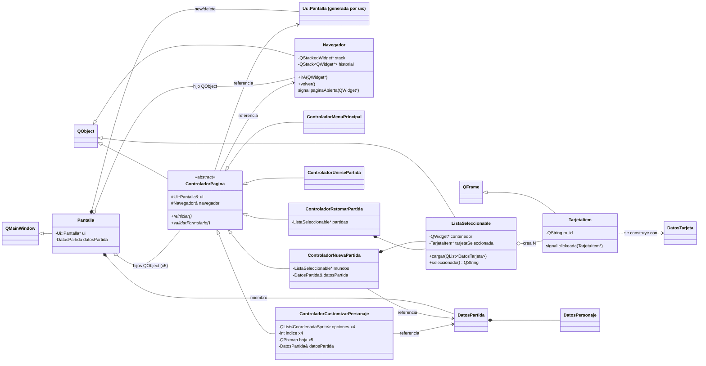

# Informe técnico — Cliente Qt del lobby (`client_src/Pantallas/`)

> Todas las rutas de este informe son relativas a `client_src/Pantallas/`, salvo que se indique otra cosa.
> Archivos leídos: `main.cpp`, los 14 `.h` de `headers/`, los 10 `.cpp` de `implementaciones/`, `pantalla.ui`, `Images.qrc`, `CMakeLists.txt` y `.gitignore`.
> Las discrepancias con la descripción que me pasaron están marcadas con **⚠️ Discrepancia**, y las observaciones propias con **🔎 Observación**.

---

## 1. Resumen general

El lobby es una aplicación Qt Widgets de **una sola ventana** (`Pantalla`, 1280×720, `pantalla.ui:9-10`). Contiene un `QStackedWidget` con **cinco páginas**:

| Página (`.ui`) | Qué muestra | Controlador |
|---|---|---|
| `pageMenuPrincipal` (`pantalla.ui:20`) | Cartel del juego y botones *Nueva Partida*, *Unirse a partida* y *Retomar Partida* | `ControladorMenuPrincipal` |
| `pageNuevaPartida` (`pantalla.ui:742`) | Campo de nombre de la partida, lista de mundos, *Volver* y *Siguiente* | `ControladorNuevaPartida` |
| `pageUnirsePartida` (`pantalla.ui:956`) | Campo de código de la partida, *Volver* y *Siguiente* | `ControladorUnirsePartida` |
| `pageRetomarPartida` (`pantalla.ui:123`) | Lista de partidas guardadas, *Volver* y *Jugar* | `ControladorRetomarPartida` |
| `pageCustomizarPersonaje` (`pantalla.ui:257`) | Nombre del personaje, gorro, pelo, remera y pantalón con flechas, *Volver* y *Jugar* | `ControladorCustomizarPersonaje` |

Cobertura de la sección **"Iniciando una partida"** del enunciado:

- **Pantalla principal**: permite elegir entre empezar una partida nueva, unirse o retomar. ✅
- **Iniciar partida**: muestra los mundos, permite nombrar la partida y lleva a la customización del personaje y a ponerle nombre. ✅ (falta el envío al servidor)
- **Unirse**: se ingresa el código y se pasa a la **misma** pantalla de customización, sin elegir granja. ✅ (el código **no se guarda**; ver §7)
- **Retomar**: muestra nombre de partida, nombre de personaje, una imagen y si es multiplayer. ✅ parcial (la imagen es un placeholder y *Jugar* no hace nada)
- **Código multiplayer**: según el enunciado se genera *dentro del juego*, así que está fuera del alcance del lobby.

Todos los datos que se muestran (mundos y partidas) son **mocks locales** (`implementaciones/partidas_estaticas.cpp`). Todavía no hay comunicación con el servidor.

---

## 2. Arquitectura

### 2.1 Diagrama de clases



### 2.2 Patrón Vista / Controlador por página

- **Vista**: `pantalla.ui` define todos los widgets con posiciones absolutas (`geometry`). En todo el archivo hay **un solo layout** (`pantalla.ui:17`, el `QVBoxLayout` que contiene al `QStackedWidget`), y las páginas no tienen layouts internos. `uic` genera `Ui::Pantalla`, una struct con un puntero a cada widget.
- **Controlador**: hay una clase por página, que hereda de `ControladorPagina` (`headers/controlador_pagina.h:11`). En su constructor cada controlador:
  1. configura el estado inicial de los widgets de su página (por ejemplo, deshabilita el botón de avanzar),
  2. conecta las señales de esos widgets a lambdas,
  3. si corresponde, carga datos (mundos o partidas) en una `ListaSeleccionable`.
- **Composición**: `Pantalla` (`implementaciones/pantalla.cpp:10-21`) es el único lugar donde se instancian las piezas y se cablean entre sí. Después de construirlas no guarda punteros a los controladores, porque los mantiene vivos el árbol de `QObject`.
- **Navegación**: ningún controlador cambia de página tocando el `QStackedWidget` directamente. Siempre pasa por `Navegador::irA` o `Navegador::volver`.

---

## 3. Clases y archivos

### 3.1 `main.cpp`
Crea la `QApplication` (`main.cpp:7`), registra la fuente `Stardew_Valley.otf` desde los recursos (`main.cpp:8-9`), construye la `Pantalla` en el stack (`main.cpp:10`), la muestra y entra al loop de eventos (`main.cpp:12`).

### 3.2 `Pantalla` — `headers/pantalla.h`, `implementaciones/pantalla.cpp`
- **Responsabilidad**: es el *composition root*. Es dueña de la vista y del estado compartido del lobby.
- **Miembros**: `Ui::Pantalla *ui` (`pantalla.h:19`) y `DatosPartida datosPartida` por valor (`pantalla.h:20`).
- **Constructor** (`pantalla.cpp:10-21`):
  - `ui->setupUi(this)` y arranque en `pageMenuPrincipal` (`:12-13`).
  - `new Navegador(ui->stackedWidget, this)` (`:15`).
  - Crea los cinco controladores, todos con `parent = this` (`:16-20`). Solo `NuevaPartida` y `CustomizarPersonaje` reciben `datosPartida` (`:17`, `:20`).
- **Destructor**: `delete ui` (`pantalla.cpp:23`). Es el único `delete` manual de toda la carpeta, aparte de los de `ListaSeleccionable::limpiar` (ver §3.6).

### 3.3 `ControladorPagina` — `headers/controlador_pagina.h`
- Clase base abstracta que hereda de `QObject` y no tiene `.cpp`.
- Su constructor recibe `Ui::Pantalla&`, `Navegador&` y `QObject *parent` (`:13-14`), y guarda los dos primeros como referencias `protected` (`:19-20`).
- Define el contrato con dos virtuales puras: `reiniciar()` (`:15`) y `validarFormulario()` (`:16`).
- Usa una *forward declaration* de `Ui::Pantalla` (`:7-9`) para no incluir `ui_pantalla.h` en el header.
- 🔎 **Observación**: no tiene `Q_OBJECT`. Hoy no lo necesita porque no declara señales ni slots. También falta un destructor virtual explícito, pero `~QObject()` ya es virtual, así que no es un error.
- 🔎 **Observación**: `reiniciar()` y `validarFormulario()` **nunca se invocan de forma polimórfica** (a través de un `ControladorPagina*`). Cada controlador las llama sobre sí mismo. La interfaz sirve hoy como contrato documental y no como punto de despacho.

### 3.4 Controladores concretos

#### `ControladorMenuPrincipal` — `implementaciones/controlador_menu_principal.cpp`
- Conecta los tres botones a `navegador.irA(...)`: Nueva (`:8-9`), Unirse (`:10-11`) y Retomar (`:12-13`).
- `reiniciar()` y `validarFormulario()` están vacíos (`:16-17`), porque esta página no tiene estado.

#### `ControladorNuevaPartida` — `implementaciones/controlador_nueva_partida.cpp`
- Crea una `ListaSeleccionable` sobre `ui.scrollAreaWidgetContents_2` (`:12`) y le carga los mundos (`:14`, `cargarMundos` en `:42-48`).
- Arranca con *Siguiente* deshabilitado (`:16`).
- **Volver** ejecuta `reiniciar()` y después `navegador.volver()` (`:18-21`).
- Re-valida el formulario cuando cambia el texto del nombre (`:23-24`) y cuando se selecciona un mundo, a través del callback (`:26`).
- **Siguiente** (`:28-33`): guarda `nombrePartida` (con `trimmed()`) e `idMundo = mundos->seleccionado()` en `datosPartida`, y navega a Customizar.
- `validarFormulario()` (`:36-40`): habilita *Siguiente* si el nombre no está vacío **y** hay un mundo seleccionado.
- `reiniciar()` (`:50-55`): deselecciona el mundo, limpia el campo, re-valida y **resetea todo `DatosPartida`** (`:54`).
- `cargarMundos()` (`:42-48`): convierte cada `MundoMock` en una `DatosTarjeta` y usa **el nombre del mundo como id** (`:45`).

#### `ControladorUnirsePartida` — `implementaciones/controlador_unirse_partida.cpp`
- Arranca con *Siguiente* deshabilitado (`:8`).
- **Volver** ejecuta `reiniciar()` y después `volver()` (`:9-12`).
- `textChanged` dispara `validarFormulario()` (`:13-14`), que habilita *Siguiente* si el código no está vacío (`:19-22`).
- **Siguiente** solo navega a Customizar (`:15-16`).
- ⚠️ **Discrepancia / pendiente**: este controlador **no recibe `DatosPartida`** (ver su constructor en `headers/controlador_unirse_partida.h:8-9` y `pantalla.cpp:18`), así que el código ingresado se pierde. Ya figura en los pendientes conocidos.

#### `ControladorRetomarPartida` — `implementaciones/controlador_retomar_partida.cpp`
- Crea una `ListaSeleccionable` sobre `ui.scrollAreaWidgetContents` (`:11`) y le carga las partidas (`:13`, `cargarPartidas` en `:31-41`).
- Cada tarjeta tiene: id = `nombrePartida`, título = `nombrePartida`, subtítulo = `nombrePersonaje`, texto extra = "Multiplayer"/"Singleplayer" y botón "Seleccionar" (`:34-38`).
- Arranca con `botJugarRP` deshabilitado (`:15`) y lo habilita cuando hay una selección (`:22`, `:25-29`).
- **Volver** ejecuta `reiniciar()` (deseleccionar y re-validar, `:43-46`) y después `volver()` (`:17-20`).
- ⚠️ **Pendiente**: `botJugarRP` **no tiene ningún `connect`**, así que apretarlo no hace nada.

#### `ControladorCustomizarPersonaje` — `implementaciones/controlador_customizar_personaje.cpp`
- **Estado propio** (`headers/controlador_customizar_personaje.h:24-38`):
  - 4 listas `QList<CoordenadaSprite>` con las opciones disponibles,
  - 4 índices `int` (empiezan en 0),
  - 5 `QPixmap` con las hojas de sprites.
- **Constructor** (`:36-50`):
  - deshabilita *Jugar* (`:40`),
  - conecta *Volver* para que ejecute `reiniciar()` y después `volver()` (`:41-44`),
  - re-valida cuando cambia el nombre (`:45-46`),
  - llama a `inicializarListas()`, `conectarBotonesFlechas()` y `actualizarPrevisualizacion()` (`:47-49`).
- `validarFormulario()` (`:52-55`): habilita *Jugar* si el nombre del personaje no está vacío.
- `reiniciar()` (`:57-66`): limpia el nombre, pone los 4 índices en 0, refresca la preview, re-valida y resetea **solo** `datosPartida.personaje` (`:65`).
- `inicializarListas()` (`:68-78`): carga las tablas de coordenadas (`:69-72`) y las 4 hojas desde recursos (`:74-77`).
- `cambiarOpcion()` (`:80-86`): avanza o retrocede de forma cíclica con `(i + dir + n) % n`. Sumar `n` evita módulos negativos: por ejemplo, desde 0 hacia atrás con 6 opciones da `(0 - 1 + 6) % 6 = 5`.
- `conectarBotonesFlechas()` (`:88-128`): conecta 8 flechas (`:89-115`) y el botón **Jugar** (`:116-127`). Jugar copia el nombre (con `trimmed()`) y los 4 índices a `datosPartida.personaje` y hace un `qDebug()` con todo `DatosPartida` (`:124-126`).
- `actualizarPrevisualizacion()` (`:130-139`): llama a `recortarSprite` para cada prenda y asigna el resultado a `mostrarGorro`, `mostrarPelo`, `mostrarRemera` y `mostrarPantalon`.
- 🔎 **Observación**: `hojaBase` está declarada (`headers/controlador_customizar_personaje.h:38`) pero **nunca se carga ni se usa**.

### 3.5 `Navegador` — `headers/navegador.h`, `implementaciones/navegador.cpp`
- Envuelve un `QStackedWidget*` (que no le pertenece) y mantiene un `QStack<QWidget*> historial` (`navegador.h:21-22`).
- `irA(pagina)` (`navegador.cpp:6-10`): apila la página actual, muestra `pagina` y emite `paginaAbierta(pagina)`.
- `volver()` (`navegador.cpp:12-16`): si el historial está vacío no hace nada; si no, desapila y muestra esa página.
- 🔎 **Observación**: **nadie conecta** la señal `paginaAbierta`, y `volver()` no la emite. Queda como punto de extensión (por ejemplo, para pedirle datos al servidor al entrar a una página).

### 3.6 `ListaSeleccionable` — `headers/lista_seleccionable.h`, `implementaciones/lista_seleccionable.cpp`
- Componente de **lista de tarjetas con selección única**. No es un widget: es un `QObject` que maneja tarjetas dentro de un `QWidget *contenedor` que recibe de afuera (por ejemplo, el contenido de un `QScrollArea`).
- Constructor (`:4-8`): si el contenedor no tiene layout, le asigna un `QVBoxLayout`.
- `cargar(items)` (`:10-18`): llama a `limpiar()`, crea una `TarjetaItem` por cada `DatosTarjeta` con `parent = contenedor`, conecta `clickeada` con `seleccionar` y la agrega al layout.
- `seleccionar(t)` (`:47-53`, privado): deselecciona la anterior, marca la nueva y ejecuta el callback `accionAlSeleccionar` si está definido.
- `deseleccionar()` (`:20-24`), `haySeleccion()` (`:26-28`) y `seleccionado()` (`:30-32`, devuelve el id o un `QString` vacío).
- `limpiar()` (`:34-41`): saca cada ítem del layout y hace `delete` del widget y del `QLayoutItem`. Estos son `delete` explícitos, porque `takeAt` le devuelve el ítem al llamador.
- `setAlSeleccionar(std::function<void()>)` (`:43-45`): el aviso de selección se hace con un callback y no con una señal Qt.
- 🔎 **Observación**: `lista_seleccionable.h` usa `std::function` pero no incluye `<functional>`. Hoy compila porque lo traen los headers de Qt de forma transitiva.

### 3.7 `TarjetaItem` y `DatosTarjeta` — `headers/tarjeta_item.h`, `implementaciones/tarjeta_item.cpp`
- `DatosTarjeta` (`tarjeta_item.h:7-14`) es un **DTO de presentación** con `id`, `rutaImagen`, `titulo`, `subtitulo`, `textoExtra` y `textoBoton`. No sabe si representa un mundo o una partida.
- `TarjetaItem` es un `QFrame` de alto fijo de 80 px (`tarjeta_item.cpp:9`, `:36`) con cursor de mano (`:37`). Su layout:
  - una imagen de 64×64 escalada con `KeepAspectRatio` (`:41-47`),
  - una columna de textos con el título y, si existe, el subtítulo (`:49-54`),
  - el texto extra alineado a la derecha, si existe (`:56-58`),
  - un botón (`:60-62`).
- La tarjeta emite `clickeada(this)` tanto desde el botón interno (`:64-65`) como desde `mousePressEvent` (`:68-71`). Los `QLabel` no consumen el click, así que este llega al `QFrame`. El `QPushButton` sí lo consume, y por eso se emite una sola vez.
- `setSeleccionada(bool)` (`:73-75`) cambia entre dos *stylesheets* (`:21-24`).
- Los estilos y tamaños están definidos como `const` en un namespace anónimo (`:8-31`).

### 3.8 `DatosPartida` / `DatosPersonaje` — `headers/datos_partida.h`
```cpp
struct DatosPersonaje { QString nombre; int gorro = 0; int pelo = 0; int pantalon = 0; int remera = 0; }; // :6-12
struct DatosPartida  { QString nombrePartida; QString idMundo; DatosPersonaje personaje; };          // :14-18
```
- Los campos de apariencia son **índices** dentro de las listas de opciones, no coordenadas de sprite.
- ⚠️ **Discrepancia (menor)**: `DatosPartida` todavía **no tiene un campo para el código** de Unirse ni para el modo (Nueva / Unirse / Retomar).

### 3.9 `partidas_estaticas` — `headers/partidas_estaticas.h`, `implementaciones/partidas_estaticas.cpp`
- Define `MundoMock {nombreMundo, rutaImagen}` (`.h:7-10`) y `PartidaGuardada {nombrePartida, nombrePersonaje, rutaImagen, esMultiplayer}` (`.h:12-17`).
- `obtenerPartidasDePrueba()` devuelve 4 partidas (`.cpp:8-15`) y `obtenerMundosDePrueba()` devuelve 2 mundos (`.cpp:17-22`).
- Todos usan la misma imagen, `IMAGEN_PRUEBA` = `01-inicio_screen.png` (`.cpp:4-5`).
- 🔎 **Observación**: el mundo `"Granja2 "` tiene un espacio al final (`.cpp:20`). Como el id del mundo es su nombre (`controlador_nueva_partida.cpp:45`), ese espacio forma parte del id.
- 🔎 **Observación**: `bool esMultiplayer = 0` (`.h:16`) debería escribirse `false`.

### 3.10 `constantes.h` — `headers/constantes.h`
Son todas `#define`, agrupadas así:
- **Base de coordenadas**: `BASE_COORDENADAS 1` (`:4`).
- **Celdas de las hojas**: `ANCHO_*` y `ALTO_*` de gorro (20×20), pelo (16×32), remera (8×8) y pantalón (16×32) (`:7-14`).
- **Escalas**: remera 5, pelo 3, gorro 3, pantalón 5 (`:17-20`).
- **Recortes**: `ALTO_RECORTE_PELO 16`, `ALTO_RECORTE_PANTALON 16` y `OFFSET_Y_PANTALON 16` (`:23-25`).
- **Direcciones**: `DIRECCION_ANTERIOR -1` y `DIRECCION_SIGUIENTE 1` (`:27-28`).
- **Rutas de recursos** de las hojas (`:31-34`).
- **Textos de UI**: `ELEGIR_MAPA`, `TEXTO_MULTIPLAYER`, `TEXTO_SINGLEPLAYER` y `TEXTO_SELECCIONAR` (`:37-42`).

⚠️ **Discrepancia con "sin números mágicos / constantes en `constantes.h`"**: la regla se aplica solo en parte.
- `tarjeta_item.cpp:9-24` define `ALTO_TARJETA`, `TAMANIO_IMAGEN` y los estilos como `const` locales, no como `#define` en `constantes.h`, y tiene un literal `"border: none;"` en `:46`.
- `partidas_estaticas.cpp:4` define `IMAGEN_PRUEBA` como `const QString`.
- `main.cpp:9` tiene la ruta de la fuente escrita como literal.
- Las tablas de coordenadas de `controlador_customizar_personaje.cpp:69-72` son datos literales. Esto es razonable, porque son una tabla de catálogo y no números mágicos sueltos, pero conviene poder justificarlo.

### 3.11 `pantalla.ui`
- La ventana es de 1280×720 (`:9-10`) y su `windowTitle` es `"Pantalla"` (`:14`). Tiene `menubar` y `statusbar` vacíos (`:1105-1115`).
- Cada página tiene un fondo con `border-image` y un "cartel" de madera (`cartel-datos.png`) como `QLabel`.
- Los botones usan `border-image` con tres estados: normal, `:pressed` y `:disabled`. El estado deshabilitado (`Boton_bw.png`) está definido **solo** en los botones que se validan: `botJugarRP` (`:186`), `botJugar` (`:362`), `botSiguiente` (`:892`) y `botSiguienteUP` (`:1048`). Así se implementa visualmente el "botón en gris".
- 🔎 **Observación**: el título de la página Retomar dice **"Partidas a unirte"** (`pantalla.ui:162`), y el label se llama `codigoPartidaRetomar` (`:147`). El texto y el nombre parecen heredados de la pantalla Unirse y pueden confundir al usuario.
- 🔎 **Observación**: los labels de la preview tienen tamaños fijos más chicos que algunos sprites escalados (ver §5.5). El pelo y el pantalón probablemente se vean **recortados**.

### 3.12 `Images.qrc`
- Recursos agrupados por prefijo: `/botones`, `/flechas`, `/pantallas`, `/ropas`, `/cartel` y `/fuentes`.
- 🔎 **Observación**: el `.qrc` **se incluye a sí mismo** como recurso (`Images.qrc:3`, `<file>Images.qrc</file>`).
- 🔎 **Observación**: se embeben archivos que no se usan:
  - `StardewValley_Character_Accessories.png` y `StardewValley_Character_Farmer Base.png`,
  - `Stardew_Valley.ttf` (solo se carga el `.otf`) y `Fonts Magazine.txt`,
  - varios fondos (`02_pantalla_nueva_partida.jpg`, `0232_…`, `03-unirse…png`), que conviene verificar.

### 3.13 `CMakeLists.txt`
- Es un proyecto **independiente** (`project(Pantallas)`, `:2`) que requiere Qt6 ≥ 6.5 con `Core` y `Widgets` (`:4`).
- `qt_standard_project_setup()` activa AUTOMOC/AUTOUIC (`:6`), `CMAKE_AUTORCC ON` compila el `.qrc` (`:7`) y `AUTOUIC_SEARCH_PATHS` indica dónde está el `.ui` (`:8`).
- Lista los fuentes uno por uno (`:11-39`).
- ⚠️ **Discrepancia con el enunciado**: **no fija el estándar C++20** (no hay `CMAKE_CXX_STANDARD` ni `target_compile_features`). Hoy compila porque el GCC local usa C++20 por defecto, pero en Ubuntu 24.04 (GCC 13, que por defecto usa `gnu++17`) no se estaría compilando con el estándar que pide el enunciado.
- No está integrado al `CMakeLists.txt` raíz, que no menciona Qt ni `Pantallas`.

---

## 4. Flujos de navegación

Notación: **H** = historial del `Navegador` (el tope a la derecha) y **D** = `DatosPartida`.

### 4.1 Menú → Nueva partida → Customizar → Jugar
| Paso | Acción | Código | Historial | Qué se guarda / limpia |
|---|---|---|---|---|
| 0 | Arranque | `pantalla.cpp:13` | `[]` | D vacío y todos los botones de avanzar deshabilitados |
| 1 | Click *Nueva Partida* | `controlador_menu_principal.cpp:8-9` | `[Menú]` | — |
| 2 | Escribir nombre y elegir mundo | `controlador_nueva_partida.cpp:23-26`, `:36-40` | `[Menú]` | Solo estado de los widgets; *Siguiente* se habilita cuando están las dos cosas |
| 3 | Click *Siguiente* | `controlador_nueva_partida.cpp:28-33` | `[Menú, Nueva]` | **D.nombrePartida** y **D.idMundo** se guardan |
| 4 | Elegir prendas y nombre | `controlador_customizar_personaje.cpp:80-86`, `:52-55` | `[Menú, Nueva]` | Solo los índices locales del controlador |
| 5 | Click *Jugar* | `controlador_customizar_personaje.cpp:116-127` | `[Menú, Nueva]` | **D.personaje** se guarda (nombre y 4 índices) y se hace `qDebug` de D. **No navega**: queda en Customizar |

### 4.2 Menú → Unirse → Customizar
| Paso | Acción | Código | Historial | Qué se guarda / limpia |
|---|---|---|---|---|
| 1 | Click *Unirse a partida* | `controlador_menu_principal.cpp:10-11` | `[Menú]` | — |
| 2 | Escribir código | `controlador_unirse_partida.cpp:13-14`, `:19-22` | `[Menú]` | Habilita *Siguiente* |
| 3 | Click *Siguiente* | `controlador_unirse_partida.cpp:15-16` | `[Menú, Unirse]` | ⚠️ **No se guarda nada**; el código queda solo en el `QLineEdit` |
| 4 | Click *Jugar* | `controlador_customizar_personaje.cpp:116-127` | `[Menú, Unirse]` | Se guarda D.personaje. El `qDebug` muestra `nombrePartida` e `idMundo` vacíos |

### 4.3 Menú → Retomar
| Paso | Acción | Código | Historial | Qué se guarda / limpia |
|---|---|---|---|---|
| 1 | Click *Retomar Partida* | `controlador_menu_principal.cpp:12-13` | `[Menú]` | — |
| 2 | Click en una tarjeta | `lista_seleccionable.cpp:47-53` → `controlador_retomar_partida.cpp:22` | `[Menú]` | La tarjeta queda resaltada y se habilita *Jugar* |
| 3 | Click *Jugar* | — | `[Menú]` | ⚠️ **Nada**: no hay `connect` |

### 4.4 Volver en cada pantalla
Todas siguen el mismo patrón: primero `reiniciar()` y después `navegador.volver()`.

| Pantalla | Código | Qué limpia `reiniciar()` | Destino |
|---|---|---|---|
| Nueva partida | `controlador_nueva_partida.cpp:18-21`, `:50-55` | Selección de mundo, campo de nombre y **todo D** | Menú |
| Unirse | `controlador_unirse_partida.cpp:9-12`, `:24-27` | Campo de código (D no se toca) | Menú |
| Retomar | `controlador_retomar_partida.cpp:17-20`, `:43-46` | Selección de tarjeta | Menú |
| Customizar | `controlador_customizar_personaje.cpp:41-44`, `:57-66` | Nombre, índices en 0, preview y **solo D.personaje** | La página anterior (Nueva o Unirse, según el historial) |
| Menú | — | No tiene botón Volver; `volver()` con el historial vacío no hace nada (`navegador.cpp:13-14`) | — |

**Comportamientos que se derivan de lo anterior:**
- **Customizar → Volver → Nueva**: los campos de Nueva **siguen completos** (nadie llamó a su `reiniciar`) y D conserva `nombrePartida` e `idMundo`. El usuario puede corregirlos y apretar *Siguiente* de nuevo, lo que sobrescribe D.
- **D no puede quedar "contaminado" al pasar a Unirse**: la única forma de salir de Nueva hacia el Menú es su *Volver*, que resetea D. Es la justificación de `controlador_nueva_partida.cpp:54`.
- **Después de *Jugar***, como no se navega, el usuario puede seguir editando y apretar *Jugar* otra vez, lo que sobrescribe D.personaje. El botón no se deshabilita al apretarlo.

---

## 5. Sistema de sprites de customización

### 5.1 Carga de las hojas
`inicializarListas()` llama a `QPixmap::load` con las rutas `:/ropas/...` definidas en `constantes.h:31-34` (`controlador_customizar_personaje.cpp:74-77`). Las imágenes vienen del `.qrc`, es decir, están **compiladas dentro del ejecutable**, y se cargan **una sola vez** en el constructor. Cada cambio de prenda solo recorta y escala la hoja que ya está en memoria.

Tamaños reales de las hojas (medidos con `file`):

| Hoja | Tamaño | Celda | Grilla |
|---|---|---|---|
| Hats | 240×880 | 20×20 | 12 col × 44 filas |
| Hairstyles | 256×672 | 16×32 | 16 col × 21 filas |
| Shirts | 256×608 | 8×8 | 32 col × 76 filas |
| Pants | 1920×1376 | 16×32 | 120 col × 43 filas |

Todas las coordenadas de `controlador_customizar_personaje.cpp:69-72` caen dentro de sus hojas.

### 5.2 `CoordenadaSprite` y base 1
`struct CoordenadaSprite { int fila; int columna; }` (`headers/controlador_customizar_personaje.h:10-13`). Las tablas usan **base 1** (fila 1 y columna 1 son la celda de arriba a la izquierda), porque es más cómodo contar celdas a ojo sobre la imagen. La conversión resta `BASE_COORDENADAS` (`constantes.h:4`).

### 5.3 `MedidasSprite` y `recortarSprite`
Ambos están en un namespace anónimo de `controlador_customizar_personaje.cpp:6-34`, así que son privados a la unidad de traducción.

```cpp
struct MedidasSprite { int anchoCelda, altoCelda, anchoRecorte, altoRecorte, offsetY, escala; }; // :7-14

QPixmap recortarSprite(const QPixmap &hoja, const CoordenadaSprite &coord, const MedidasSprite &m) {
  int x = (coord.columna - BASE_COORDENADAS) * m.anchoCelda;               // :28
  int y = (coord.fila    - BASE_COORDENADAS) * m.altoCelda + m.offsetY;    // :29
  return hoja.copy(x, y, m.anchoRecorte, m.altoRecorte)                    // :30
             .scaled(m.anchoRecorte * m.escala, m.altoRecorte * m.escala,
                     Qt::KeepAspectRatio, Qt::FastTransformation);         // :31-32
}
```

- **Celda vs. recorte**:
  - La **celda** (`anchoCelda` × `altoCelda`) es el paso de la grilla, y sirve para *ubicar* el sprite en la hoja.
  - El **recorte** (`anchoRecorte` × `altoRecorte`) es la porción que *se muestra* desde esa posición.
  - Para el gorro y la remera son iguales. Para el pelo y el pantalón la celda mide 32 de alto, pero se recortan solo 16 (`ALTO_RECORTE_PELO`, `ALTO_RECORTE_PANTALON`): del pelo se muestra la mitad superior y del pantalón la inferior.
- **Offset del pantalón**: `OFFSET_Y_PANTALON = 16` (`constantes.h:25`) desplaza el recorte 16 px hacia abajo **dentro de la celda**, para mostrar las piernas en lugar de la cintura. Es el único `MedidasSprite` con `offsetY ≠ 0` (`:22-24`).
- **Escalado**: el factor es entero (3 o 5) y se usa `Qt::FastTransformation`, que es *nearest-neighbor*. Así el pixel art se agranda sin interpolar ni ponerse borroso. Como el ancho y el alto se multiplican por el mismo factor, `KeepAspectRatio` no tiene efecto práctico.
- Las cuatro instancias `MEDIDAS_GORRO`, `MEDIDAS_PELO`, `MEDIDAS_REMERA` y `MEDIDAS_PANTALON` (`:16-24`) reemplazan el código repetido por prenda con una sola función parametrizada.

### 5.4 Ejemplos numéricos reales

**Pantalón, opción 1** (índice 1 → `{1, 25}`, `controlador_customizar_personaje.cpp:71`):
- `x = (25 − 1) × 16 = 384`
- `y = (1 − 1) × 32 + 16 = 16`
- `copy(384, 16, 16, 16)` da un recorte de 16×16. Escalado ×5 queda en **80×80**.

**Pelo, opción 3** (índice 3 → `{13, 6}`, `:69`):
- `x = (6 − 1) × 16 = 80`
- `y = (13 − 1) × 32 + 0 = 384`
- `copy(80, 384, 16, 16)` escalado ×3 queda en **48×48**.

**Gorro por defecto** (índice 0 → `{13, 10}`, `:70`):
- `x = 9 × 20 = 180`, `y = 12 × 20 = 240`
- `copy(180, 240, 20, 20)` escalado ×3 queda en **60×60**.

**Remera, opción 4** (`{25, 9}`, `:72`):
- `x = 8 × 8 = 64`, `y = 24 × 8 = 192`
- Escalado ×5 queda en **40×40**.

### 5.5 🔎 Observación: tamaño de los sprites vs. tamaño de los labels
Los `QLabel` de la preview tienen geometría fija y no usan `scaledContents`:

| Prenda | Pixmap | Label (`.ui`) | Resultado |
|---|---|---|---|
| Gorro | 60×60 | 60×60 (`pantalla.ui:682-683`) | Entra justo |
| Pelo | 48×48 | 60×40 (`:698-699`) | **Sobran 8 px de alto**: se recorta |
| Remera | 40×40 | 60×40 (`:714-715`) | Entra |
| Pantalón | 80×80 | 60×50 (`:730-731`) | **Sobran 20×30 px**: se recorta |

Un `QLabel` no reescala el pixmap; con `AlignCenter` lo centra y corta lo que no entra. Conviene verificarlo visualmente y ajustar las escalas o la geometría de los labels.

---

## 6. Decisiones de diseño y justificación

1. **Inyección de dependencias por constructor** (`ui`, `navegador` y `datosPartida`).
   - Ningún controlador usa globales ni singletons: todo llega por constructor (`controlador_pagina.h:13`, `controlador_nueva_partida.h:10-12`, `controlador_customizar_personaje.h:17-19`).
   - Así cada clase declara explícitamente de qué depende, y se pueden pasar dobles de prueba.
   - El canal hacia el servidor se va a poder sumar de la misma forma.
   - ✅ Coincide con la descripción.

2. **Navegador con historial `QStack`**.
   - `irA` apila y `volver` desapila (`navegador.cpp:6-16`), así que ninguna página conoce cuál es su "anterior".
   - Gracias a eso, `pageCustomizarPersonaje` es **una sola página**, a la que se llega desde Nueva (`controlador_nueva_partida.cpp:32`) y desde Unirse (`controlador_unirse_partida.cpp:16`), y su *Volver* regresa a la que corresponda. Esto cumple lo que pide el enunciado: *"lo llevará a la misma pantalla inicial de customización"*.
   - ✅ Coincide con la descripción.

3. **`DatosPartida` compartido, con `Pantalla` como dueña y pasado por referencia**.
   - Es miembro por valor de `Pantalla` (`pantalla.h:20`).
   - `NuevaPartida` escribe el nombre y el mundo en *Siguiente* (`controlador_nueva_partida.cpp:29-31`), y `Customizar` escribe el personaje en *Jugar* (`controlador_customizar_personaje.cpp:117-122`).
   - Customizar no consulta de dónde viene.
   - ✅ Coincide con la descripción.
   - ⚠️ **Matiz**: cuando se conecte el protocolo, *Jugar* va a tener que decidir si envía "crear" o "unirse". Hoy la única forma de distinguirlos sería inferirlo de qué campos de D están completos. Es más claro agregar a D un campo de modo o el código, de manera que Customizar siga sin conocer páginas pero D sea autodescriptivo.

4. **Alcance de cada `reiniciar()`**.
   - El de Nueva resetea todo D (`controlador_nueva_partida.cpp:54`), y el de Customizar resetea solo el personaje (`controlador_customizar_personaje.cpp:65`).
   - Así, volver de Customizar a Nueva conserva el nombre y el mundo, y salir de Nueva al Menú no deja datos que después aparezcan en el flujo de Unirse.
   - ✅ Coincide con la descripción.

5. **Personaje como índices, nunca como coordenadas**.
   - `DatosPersonaje` guarda `int` (`datos_partida.h:8-11`) y *Jugar* copia `indiceGorro`, etc. (`controlador_customizar_personaje.cpp:119-122`). Las coordenadas quedan encapsuladas en el controlador (`:69-72`).
   - Por la red van a viajar ids, y el SDL o el servidor pueden tener su propio mapeo de id a sprite.
   - ✅ Coincide con la descripción.

6. **Constantes con `#define` en `constantes.h`**.
   - Se cumple para todo el sistema de sprites y para los textos de los controladores.
   - ⚠️ **No se cumple del todo**: ver §3.10 (`tarjeta_item.cpp`, `partidas_estaticas.cpp` y `main.cpp`).
   - Que los valores configurables del juego vayan en el `.toml` es coherente: en `constantes.h` no hay valores de juego, solo de presentación.

7. **Cliente dummy: las validaciones son solo de UX**.
   - Las validaciones solo verifican que haya algo escrito o seleccionado (`trimmed().isEmpty()` / `haySeleccion()`), y se aplican deshabilitando botones, con `:disabled` en el `.ui`.
   - No hay ninguna regla de dominio: no se valida unicidad de nombres, existencia de códigos ni cupo de jugadores.
   - ✅ Coincide con la descripción.

8. **Ownership mediante el árbol de `QObject`**.
   - El `Navegador` y los controladores tienen `parent = this` (`pantalla.cpp:15-20`), las `ListaSeleccionable` tienen como parent a su controlador (`controlador_nueva_partida.cpp:12`, `controlador_retomar_partida.cpp:11`) y las tarjetas tienen como parent a su contenedor (`lista_seleccionable.cpp:13`).
   - Las lambdas se conectan con `this` como *context*, así que se desconectan solas si el controlador se destruye.
   - ⚠️ **Matiz**: además de `delete ui` (`pantalla.cpp:23`), hay `delete` explícitos en `ListaSeleccionable::limpiar` (`lista_seleccionable.cpp:38-39`), que son necesarios por cómo funciona `takeAt`.
   - 🔎 **Orden de destrucción**: en `~Pantalla` primero se ejecuta `delete ui`, después se destruye el miembro `datosPartida` y recién entonces `~QObject` destruye a los controladores. Durante ese instante, los controladores tienen referencias colgantes a `ui` y a `datosPartida`. No es un problema porque sus destructores no las usan, pero es un detalle que un corrector puede preguntar. Usar `std::unique_ptr<Ui::Pantalla>` simplificaría el `delete` manual.

---

## 7. Estado actual frente al enunciado

| Requisito | Estado | Dónde |
|---|---|---|
| Pantalla principal con Nueva / Unirse / Retomar | ✅ Terminado | `controlador_menu_principal.cpp:8-13` |
| Nueva: listar mundos | ✅ UI terminada / ⏳ datos mock | `controlador_nueva_partida.cpp:42-48` |
| Nueva: nombrar partida | ✅ Terminado y guardado en D | `controlador_nueva_partida.cpp:29-30` |
| Customización de personaje (4 prendas y nombre) | ✅ Terminado y guardado en D | `controlador_customizar_personaje.cpp:116-122` |
| Misma pantalla de customización para Unirse | ✅ Terminado | `controlador_unirse_partida.cpp:15-16` |
| Unirse: guardar el código | ❌ Pendiente | `ControladorUnirsePartida` no recibe D |
| Retomar: nombre de partida, personaje y multiplayer | ✅ Terminado (mock) | `controlador_retomar_partida.cpp:34-38` |
| Retomar: imagen del personaje | ❌ Placeholder | `partidas_estaticas.cpp:4-5` |
| Retomar: cargar la partida al confirmar | ❌ `botJugarRP` sin `connect` | `controlador_retomar_partida.cpp` |
| Jugar → enviar al protocolo (y deshabilitar el botón mientras espera) | ❌ Hoy es un `qDebug` | `controlador_customizar_personaje.cpp:124-126` |
| Reemplazar `partidas_estaticas` por datos del servidor | ❌ Pendiente | `partidas_estaticas.cpp` |
| Integrar `Pantallas` al CMake raíz (un solo ejecutable con SDL) | ❌ Pendiente | `CMakeLists.txt:2` (proyecto aparte) |
| Fijar C++20 en el CMake | ❌ No está (no figuraba en la lista) | `CMakeLists.txt` |
| UX: botones deshabilitados con estilo propio | ✅ Terminado | `pantalla.ui:186, 362, 892, 1048` |

**Dónde se va a conectar el lobby** (fuera de esta carpeta, solo como referencia):
- `client_src/client_protocol.h:28-32` ya declara `send_create_match`, `send_list_matches` y `send_join_match`.
- `common_src/game_dtos.h:29` declara `enum class LobbyAction { Create, List, Join }`.
- Esos mensajes hoy transportan solo un `std::string`: no incluyen ni `DatosPersonaje` ni el mundo.
- `client_src/client.h:24` construye su propia conexión a partir de host y puerto. Para que el SDL reutilice el socket del lobby, `Client` va a tener que recibir el protocolo ya conectado.

---

## 8. Posibles preguntas del corrector

**¿Por qué no hacer todo en `Pantalla` con slots, como genera Qt Creator?**
Porque cada página tiene su propio estado y sus propias reglas, y juntarlas en una sola clase genera una "God class". Con un controlador por página, cada uno se ocupa solo de sus widgets (por ejemplo, `controlador_unirse_partida.cpp` tiene 27 líneas) y `Pantalla` queda en 11 líneas de composición (`pantalla.cpp:10-21`).

**¿Cómo sabe Customizar a dónde volver?**
No lo sabe: se lo resuelve el historial del `Navegador` (`navegador.cpp:7`, `:15`).

**¿Qué pasa si se aprieta *Volver* en el menú?**
El menú no tiene botón *Volver*. De todas formas, `volver()` con el historial vacío no hace nada (`navegador.cpp:13-14`).

**¿No es lógica de negocio que el botón esté deshabilitado?**
No. Solo se verifica que haya algo escrito o seleccionado (`controlador_nueva_partida.cpp:37-39`). No se decide si un nombre es válido, si un código existe ni si hay lugar en la partida: eso lo va a responder el servidor. Es una ayuda de UX, que el enunciado pide explícitamente (punto 3 de *Detalles técnicos*).

**¿Por qué guardan índices y no las coordenadas del sprite?**
Las coordenadas dependen de cómo están armadas las hojas en este cliente, mientras que un índice es un identificador estable que pueden entender el servidor y el SDL (`datos_partida.h:8-11`).

**¿Por qué `FastTransformation`?**
Porque hace un escalado nearest-neighbor, que mantiene los bordes nítidos del pixel art. La alternativa `SmoothTransformation` interpola y deja el sprite borroso.

**¿Por qué restan `BASE_COORDENADAS`?**
Las tablas están escritas en base 1 para que coincidan con contar celdas a ojo sobre la imagen; la resta las convierte a la base 0 que espera `QPixmap::copy` (`controlador_customizar_personaje.cpp:28-29`).

**¿Por qué el pantalón tiene `offsetY`?**
Porque su celda mide 32 px de alto y solo interesa la mitad inferior, donde están las piernas (`constantes.h:25`).

**¿Quién libera la memoria de todos los `new`?**
El árbol de `QObject`: cada objeto tiene un parent. Las únicas excepciones son `delete ui` (`pantalla.cpp:23`), porque `Ui::Pantalla` no es un `QObject`, y `limpiar()` (`lista_seleccionable.cpp:38-39`), porque `takeAt` le transfiere el ítem al llamador.

**¿Por qué `ListaSeleccionable` avisa con un callback y no con una señal?**
Hay un único interesado (el controlador dueño de la lista), y el callback evita declarar una señal. Una señal `seleccionCambiada()` sería igual de válida y más idiomática en Qt. Si lo preguntan, es una decisión defendible pero discutible.

**¿Para qué sirven `reiniciar()` y `validarFormulario()` en el menú, si están vacíos?**
Lo exige la interfaz abstracta (`controlador_pagina.h:15-16`). Conviene reconocer que hoy no se invocan de forma polimórfica, así que el beneficio es de uniformidad. Una alternativa sería darles una implementación vacía por defecto en la base.

**¿Qué pasa si dos partidas tienen el mismo nombre?**
Hoy el id de la tarjeta es el nombre (`controlador_retomar_partida.cpp:36`), así que dos partidas con el mismo nombre serían indistinguibles. Cuando vengan del servidor, el id debería ser un identificador propio de la partida. Lo mismo vale para los mundos (`controlador_nueva_partida.cpp:45`).

**¿Cómo pasan de Qt a SDL?**
Todavía no está implementado. El plan es un único ejecutable cuyo `main` cree la conexión antes de la `QApplication` y se la preste a Qt por referencia. Con el OK del servidor se cierra Qt (`QApplication::exit`) y el protocolo se mueve (`std::move`) al cliente SDL.

**¿Por qué el `.ui` usa posiciones absolutas?**
Fue una decisión de simplicidad visual para 1280×720 fijo. La contra es que la ventana no se adapta si se redimensiona, porque en todo el `.ui` hay un solo layout.

**¿Qué pasa si se aprieta *Jugar* dos veces?**
Hoy solo se sobrescribe D y se repite el `qDebug`. Al conectar el protocolo, hay que deshabilitar el botón mientras se espera la respuesta (ya está en los pendientes).
